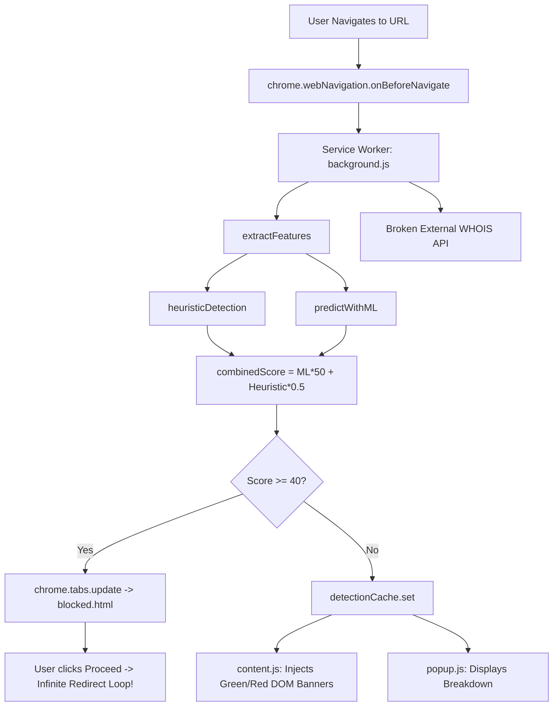

# PhishLens Web Shield: Comprehensive Architectural and Security Audit

## Executive Summary

**Project:** PhishLens Web Shield — Anti-Phishing Browser Extension (Manifest V3)  
**Audit Date:** October 2026  
**Auditor Role:** Senior Cybersecurity Engineer & Browser Security Architect  
**Initial Assessment:** Critical defects in navigation handling, machine learning scoring direction, typosquatting calculations, and DOM manipulation prevent the extension from functioning safely or reliably in a production environment. Furthermore, the existing ML model metrics were unverified with no reproducible training pipeline.

---

## 1. Inventory & Architectural Mapping

### Existing Components:
- **`manifest.json`**: MV3 manifest requesting broad host permissions (`<all_urls>`), unused permissions (`scripting`, unused `declarativeNetRequest`), and leaky `web_accessible_resources`.
- **`background.js`**: Service worker managing cache, URL feature extraction, Shannon entropy, Levenshtein distance, logistic regression, and navigation listeners (`onBeforeNavigate`, `onCommitted`).
- **`content.js`**: Injected script displaying invasive DOM banners on every site (even safe ones), containing innerHTML injection risks.
- **`popup/`**: HTML/CSS/JS interface displaying site risk, SSL, WHOIS age, and feature breakdowns.
- **`popup/blocked.html` / `blocked.js`**: Warning page shown when risk score >= 40.
- **`model/phishing_model.json`**: Weight vector and bias for 12 features with synthetic/unverified performance claims.

---

## 2. Identified Vulnerabilities, Bugs, and Weaknesses

### 2.1 Critical Severity (P0)

1. **Inverted Typosquatting Feature and Conflicting ML Weight**:
   - `detectTyposquatting(hostname)` computes `minDistance / 10`.
   - For an exact match (`google.com`), distance is `0`. For an unrelated site (`example.xyz`), distance is high (~`1.0`).
   - In `phishing_model.json`, the weight for `typosquattingScore` is `+1.95`.
   - **Flaw**: Because the weight is positive, higher values increase phishing probability. Consequently, completely normal, benign websites received a **+1.95 log-odds penalty**, while brand lookalikes received **0**.
2. **Infinite Navigation Redirect Loop**:
   - When a site is blocked, `background.js` redirects to `popup/blocked.html?url=...`.
   - If the user clicks "Proceed Anyway", `blocked.js` runs `window.location.href = blockedUrl`.
   - The navigation immediately triggers `onBeforeNavigate` again, which re-analyzes the site, re-flags it, and redirects straight back to `blocked.html`. The user is permanently trapped.
3. **Non-Blocking Asynchronous Race Condition in MV3**:
   - `chrome.webNavigation.onBeforeNavigate` is an **informative event**, not a blocking request interceptor.
   - While `analyzeURL()` runs asynchronously, the browser initiates TCP handshakes, TLS, and document rendering. Malicious scripts can execute before `chrome.tabs.update` is dispatched.
4. **Ephemerality & State Loss in Service Worker**:
   - `detectionCache` is an in-memory `Map`. MV3 service workers terminate after ~30 seconds of inactivity.
   - When the worker wakes up for a popup query or tab commit, `detectionCache` is empty and `mlModel` is null.
   - If `mlModel` is null, `predictWithML` silently falls back to returning `0.5`, skewing risk scores.
5. **DOM Injection (XSS Vulnerability)**:
   - `content.js` constructs `warningBanner.innerHTML` using `reason` string without sanitization. An attacker crafting a URL that reflects into detection reasons could achieve arbitrary script execution in the context of the visited web page.
6. **Silent Safe-by-Default Fallback on Analysis Failure**:
   - In `analyzeURL`: `if (!features) return { safe: true, score: 0, reason: 'Unable to analyze' };`
   - An invalid or maliciously malformed URL that breaks the parser is treated as **100% safe (Score 0)**! This violates core secure coding principles.

### 2.2 High Severity (P1)

7. **Invasive UX & DOM Pollution on All Safe Websites**:
   - `content.js` displays a floating green notification ("Safe URL") on **every legitimate page**, modifying `document.body.style.paddingTop`.
8. **Inaccurate Authority / `@` Trick Detection**:
   - `fullUrl.includes('@')` flags any URL containing `@` in query parameters (e.g. SSO login redirects, email search queries: `https://mail.service.com/inbox?user=test@example.com`). Only `@` in the authority/userinfo component represents an obfuscation vector.
9. **Lack of Registrable Domain / Public Suffix List (PSL) Awareness**:
   - Subdomain nesting (e.g., `paypal.com.attacker-domain.com`) is not separated into subdomain vs. registrable domain. Edit distance against `paypal.com` is calculated over the entire hostname string rather than domain labels.
10. **Unverified Machine Learning Model**:
    - `model/phishing_model.json` contains unverifiable metrics (`accuracy: 0.923`) with zero training scripts, provenance, or dataset definitions in the repository.

### 2.3 Medium Severity (P2)

11. **Privacy Leak in Domain Age Lookup**:
    - The code sends all hostnames to `https://www.whoisxmlapi.com/whoisserver/WhoisService?apiKey=at_free` over plaintext query params, exposing browsing history to a third-party service without user consent.
12. **Insecure Web Accessible Resources**:
    - `popup/blocked.html`, `popup/blocked.js`, and `model/phishing_model.json` are exposed to `"<all_urls>"`, allowing external sites to fingerprint extension installation.
13. **Unused Manifest Permissions**:
    - `"scripting"` and `"declarativeNetRequest"` are declared without active implementation.

---

## 3. Prioritized Implementation Roadmap

| Phase | Milestone | Priority | Actions |
|---|---|---|---|
| **Phase 1** | **URL Engine & Scoring Repairs** | P0 | Bundled eTLD+1 extraction, corrected typosquatting logic, safe authority parsing, Punycode/homoglyph detection, remove safe-on-error bug. |
| **Phase 2** | **Navigation & MV3 Architecture** | P0 | Persistent session storage for cache, session bypass whitelist for "Proceed Anyway", DNR / tab navigation guards, graceful SW cold-start. |
| **Phase 3** | **Content Script & UI Hardening** | P0 / P1 | Remove safe banners, use strict DOM `textContent` APIs, modern accessible popup with manual re-scan, polished warning screen. |
| **Phase 4** | **Reproducible ML Pipeline** | P1 | Python training & evaluation pipeline in `ml/`, verified dataset and deterministic baseline, feature metadata export, browser parity validation. |
| **Phase 5** | **Threat Intelligence & Privacy** | P1 / P2 | Remove hardcoded WHOIS, build pluggable threat intel interface with local bloom/hash caching and mock fallback, update `manifest.json`. |
| **Phase 6** | **Automated Testing Suite & CI** | P0 / P1 | Jest/Vitest unit & integration tests for JS engine, Pytest for ML pipeline, GitHub Actions workflow. |
| **Phase 7** | **Documentation & Packaging** | P2 | Full `README.md`, `PRIVACY.md`, threat model, architecture docs, and limitation specifications. |
